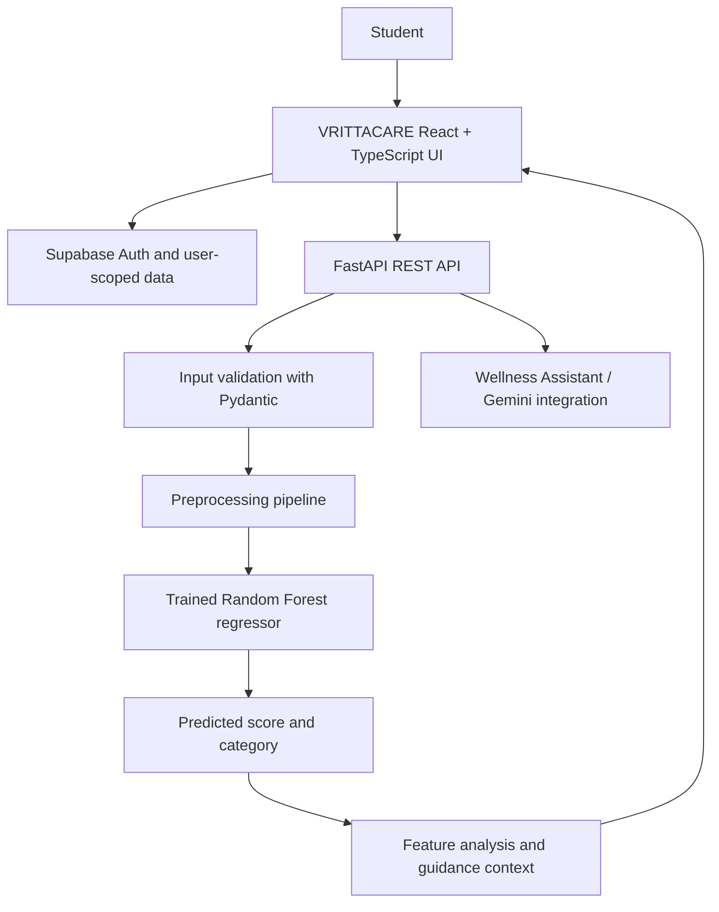

# VRITTACARE — Student Mental Health Score Prediction

<p align="center">
  <strong>A student-focused wellness experience powered by machine learning.</strong><br/>
  From everyday habits to understandable insights and practical next steps.
</p>

<p align="center">
  <a href="https://students-mental-health-frontend.onrender.com"></a>
  <a href="https://students-mental-health-backend-1.onrender.com/docs"></a>
  <a href="https://github.com/rutuu0228/Students_Mental_Health_Score_Prediction_sys"></a>
</p>

<p align="center">
  
  
  
  
  
  
  
</p>

---

## 🌐 Live application

| Service | Link |
|---|---|
| **VRITTACARE frontend** | [Open the live application](https://students-mental-health-frontend.onrender.com) |
| **FastAPI backend** | [Open the backend service](https://students-mental-health-backend-1.onrender.com) |
| **Interactive API documentation** | [Explore endpoints in Swagger UI](https://students-mental-health-backend-1.onrender.com/docs) |
| **API health check** | [Check service health](https://students-mental-health-backend-1.onrender.com/health) |

> Render services on free or sleeping plans may need a short warm-up period after inactivity.

## 🧭 What is VRITTACARE?

**VRITTACARE** is an end-to-end student mental-health score prediction and wellness-insight system. It combines a trained regression model with a calm, interactive web application to help students reflect on patterns in their daily routines.

A student completes a lifestyle assessment covering sleep, study time, physical activity, screen usage, phone unlock frequency, stress, and selected demographic or academic details. The backend processes those answers with the trained prediction pipeline and returns a score, a project-defined category, and feature-level observations. The application presents the result through visual summaries and practical, non-judgmental suggestions.

**Assessment → Prediction → Understanding → Small, practical actions**

This is an educational project for self-reflection. It does **not** diagnose a mental-health condition, replace a qualified professional, or establish that any lifestyle factor causes a mental-health outcome.

## ✨ Product highlights

- **Account access** — sign-in and account creation for a personalized experience.
- **Guided wellness assessment** — structured inputs for lifestyle, digital habits, academic context, and self-reported stress.
- **Live ML prediction** — assessment data is sent to a Python FastAPI service using the trained Random Forest pipeline.
- **Readable results** — a score gauge and project-defined score category make model output easier to understand.
- **Feature-level observations** — results are grouped into **Needs Attention**, **Can Improve / Watch**, and **Favorable / Stable** areas.
- **Personalized insights and tips** — practical next steps based on the submitted assessment and generated analysis.
- **Wellness Assistant** — a chat experience designed to explain student context in clear, supportive language.
- **Visual wellness profile** — lifestyle metrics and a 3D wellness-profile view.
- **Saved user context** — Supabase-backed authentication and user-scoped assessment, result, and chat-data workflows.
- **Project information** — an in-app About page explains the purpose, workflow, and team contributions.

## 🖼️ Application screenshots

The screenshots are stored in [VRITTACARE_screenshots](VRITTACARE_screenshots/).

### Sign in and account creation

<p align="center">
  
</p>

### Dashboard and assessment

<table>
  <tr>
    <td width="50%" align="center">
      
      <sub><strong>Personalized dashboard</strong></sub>
    </td>
    <td width="50%" align="center">
      
      <sub><strong>Wellness assessment</strong></sub>
    </td>
  </tr>
</table>

### Prediction results and wellness insights

<table>
  <tr>
    <td width="50%" align="center">
      
      <sub><strong>Prediction results</strong></sub>
    </td>
    <td width="50%" align="center">
      
      <sub><strong>Insights and tips</strong></sub>
    </td>
  </tr>
  <tr>
    <td width="50%" align="center">
      
      <sub><strong>Practical next steps</strong></sub>
    </td>
    <td width="50%" align="center">
      
      <sub><strong>3D wellness profile</strong></sub>
    </td>
  </tr>
</table>

### Wellness Assistant and project overview

<table>
  <tr>
    <td width="50%" align="center">
      
      <sub><strong>Wellness Assistant</strong></sub>
    </td>
    <td width="50%" align="center">
      
      <sub><strong>About the project</strong></sub>
    </td>
  </tr>
</table>

[Browse all screenshots →](VRITTACARE_screenshots/)

## 🏗️ System architecture



### End-to-end request flow

1. The student signs in and completes the assessment.
2. The frontend sends the assessment fields to the prediction API.
3. FastAPI validates the request with a Pydantic schema.
4. The backend applies the saved preprocessing transformer and trained Random Forest model.
5. The backend returns the predicted score, category, and grouped feature observations.
6. VRITTACARE renders the result as a score gauge, lifestyle summaries, and insight cards.
7. The authenticated application uses Supabase for user-scoped assessment, prediction-result, and chat-history workflows.

## 🧠 Machine-learning workflow

The analysis notebooks document the work from the original dataset through model development:

1. **Data understanding** — inspect dataset structure, columns, types, and summary statistics.
2. **Data cleaning** — check quality and duplicates; the original analysis recorded 5,000 rows and removed two duplicate records, leaving 4,998.
3. **Exploratory data analysis** — study distributions and relationships across lifestyle, digital-use, academic, and target variables.
4. **Feature engineering** — transform categorical and numerical inputs using scikit-learn preprocessing tools.
5. **Model comparison** — evaluate Linear Regression, Decision Tree, Random Forest, and Gradient Boosting regressors.
6. **Model tuning and finalization** — tune and save the model pipeline used by the prediction service.
7. **Inference and interpretation** — return a score with feature-level observations for the application.

### Dataset and input signals

| Input group | Examples |
|---|---|
| Demographic / academic | Age, gender, country, academic level |
| Digital habits | Most-used platform, purpose of use, average daily usage hours, daily phone unlocks |
| Lifestyle | Study hours, physical-activity hours, sleep hours per night |
| Self-reported well-being | Stress level |
| Prediction target | Mental Health Score (continuous regression target) |

The score categories and feature-status rules are project-defined interpretation aids, not clinical thresholds.

### Baseline model benchmark

The model-building notebook documented the following baseline comparison. These are **baseline test-set results**, not a claim that every deployed model artifact has identical performance.

| Baseline model | MAE ↓ | RMSE ↓ | R² ↑ |
|---|---:|---:|---:|
| Linear Regression | 0.475815 | 0.613455 | 0.789197 |
| Decision Tree Regressor | 0.322800 | 0.515810 | 0.850964 |
| **Random Forest Regressor** | **0.277949** | **0.385650** | **0.916690** |
| Gradient Boosting Regressor | 0.410558 | 0.529632 | 0.842870 |

Random Forest was the strongest model in this baseline comparison. MAE and RMSE measure prediction error (lower is better); R² describes the proportion of target variance explained on the evaluated test set.

## 🔌 Backend API

| Method | Endpoint | Purpose |
|---|---|---|
| **GET** | **/health** | Basic service health check |
| **POST** | **/predict** | Validate student inputs and return prediction context |
| **POST** | **/chat** | Send a message to the Wellness Assistant |
| **GET** | **/docs** | Interactive Swagger API documentation |

### Example prediction request

```json
{
  "Age": 20,
  "Gender": "Female",
  "Academic_Level": "Undergraduate",
  "Most_Used_Platform": "Instagram",
  "Purpose_Of_Use": "Entertainment",
  "Avg_Daily_Usage_Hours": 4.5,
  "Daily_Unlocks": 60,
  "Study_Hours": 3.0,
  "Physical_Activity_Hours": 1.0,
  "Sleep_Hours_Per_Night": 7.0,
  "Stress_Level": "Moderate",
  "Country": "India"
}
```

The values are illustrative request data, not a real user's profile. The API schema in the repository is the source of truth for required fields and types.

## 🧰 Technology stack

| Layer | Technologies |
|---|---|
| Frontend | React, TypeScript, TanStack Start / Router, Vite |
| UI and visualization | Tailwind CSS, Radix-based UI components, Recharts, custom wellness charts |
| Authentication and persistence | Supabase Auth, PostgreSQL, Row Level Security and user-scoped server functions |
| API | Python, FastAPI, Pydantic, Uvicorn |
| Machine learning | scikit-learn, pandas, NumPy, joblib |
| Assistant | Google Gemini API integration |
| Deployment | Render |
| Version control | Git and GitHub |

## 🚀 Run locally

### Prerequisites

- Git
- Node.js and npm (or Bun) for the frontend
- Python and pip for the backend
- Supabase project credentials for authenticated/data-backed workflows
- A Gemini API key if you want to run the backend assistant locally

### 1. Clone the repository

```bash
git clone https://github.com/rutuu0228/Students_Mental_Health_Score_Prediction_sys.git
cd Students_Mental_Health_Score_Prediction_sys
```

### 2. Run the backend

```bash
cd Backend
python -m venv .venv
```

Activate the environment:

**Windows PowerShell**
```powershell
.\.venv\Scripts\Activate.ps1
```

**macOS / Linux**
```bash
source .venv/bin/activate
```

Install dependencies and start FastAPI:

```bash
pip install -r requirements.txt
uvicorn api.main:app --reload --port 8000
```

Create a local **Backend/.env** file for private configuration, for example:

```env
GEMINI_API_KEY=replace_with_your_own_key
```

Never commit real API keys, service-role keys, or other secrets. If your setup hosts the model artifact separately, configure the optional **MODEL_URL** environment variable to point to the intended artifact.

Local API documentation: [http://127.0.0.1:8000/docs](http://127.0.0.1:8000/docs). Health check: [http://127.0.0.1:8000/health](http://127.0.0.1:8000/health).

### 3. Run the frontend

Open a second terminal at the repository root:

```bash
cd Frontend
npm install
```

Create **Frontend/.env** with the public project settings expected by the frontend:

```env
VITE_SUPABASE_URL=https://YOUR_PROJECT_REF.supabase.co
VITE_SUPABASE_PUBLISHABLE_KEY=YOUR_SUPABASE_PUBLISHABLE_KEY
PREDICTION_API_URL=https://students-mental-health-backend-1.onrender.com
```

Use your own Supabase project URL and publishable key. Set PREDICTION_API_URL to your deployed backend base URL (or your local API URL during local development). If your deployment uses an API key, configure PREDICTION_API_KEY only in the server environment. Do not commit the environment file or place secrets in source code.

```bash
npm run dev
```

Vite prints the local frontend URL in the terminal. If the frontend needs to call a different backend address for local testing, update the relevant frontend integration/configuration to use your local API URL.

## 📁 Repository guide

```text
Students_Mental_Health_Score_Prediction_sys/
├── Backend/
│   ├── api/
│   │   ├── main.py                 # FastAPI app and health endpoint
│   │   ├── schemas.py              # Pydantic request schemas
│   │   └── routes/
│   │       ├── prediction.py       # Prediction endpoint
│   │       └── chatbot.py          # Assistant endpoint
│   ├── data/                       # Backend inference data
│   ├── models/                     # Saved preprocessing/model artifacts
│   ├── feature_analysis.py         # Feature interpretation and guidance
│   ├── predictor.py                # Model loading and inference
│   ├── gemini_chatbot.py           # Assistant integration
│   ├── requirements.txt
│   └── Procfile
├── Data/                           # Raw, cleaned and processed datasets
├── Images/                         # EDA and model-analysis visuals
├── Models/                         # Shared model artefacts
├── Notebooks/                      # Reproducible data-science workflow
├── Documentation/                  # Synopsis, diagrams and presentation
├── Frontend/
│   ├── src/routes/                 # Application pages
│   ├── src/components/mb/           # VRITTACARE UI components
│   ├── src/integrations/supabase/   # Supabase and auth integration
│   └── package.json
├── VRITTACARE_screenshots/         # Application screenshots
└── README.md
```

## 🔐 Responsible use and limitations

- The score is a **model-generated estimate**, not a diagnosis.
- Category labels and feature-status rules are project-defined guidance, not validated clinical cut-offs.
- Associations learned from historical data do not prove causation.
- Results may be affected by dataset coverage, data quality, model limitations, and differences between training data and an individual student's circumstances.
- Use the application for learning and self-reflection, not for clinical decisions or emergency support.
- Treat assessment answers as personal information. Use test data where possible, keep credentials private, and review the deployed service's privacy configuration before entering sensitive information.

## 👥 Project team

### Rutuja Dhumal — Project author1

B.Sc. Data Science student | Data Science, Machine Learning, backend integration, and product experience.

- Email: [rutuu0228@gmail.com](mailto:rutuu0228@gmail.com)
- GitHub: [@rutuu0228](https://github.com/rutuu0228)
- LinkedIn: [rutuu0208](https://www.linkedin.com/in/rutuu0208/)

### Vaibhav Solanke Badrinarayan — Project author2

B.Sc. Data Science student | Data Science, Dataset Understanding, Machine Learning, and product experience

Project collaborator.

- Email: [solankevaibhavbadrinarayan@gmail.com](mailto:solankevaibhavbadrinarayan@gmail.com)

## 🎓 What this project demonstrates

- End-to-end delivery across a data-science workflow, trained model, API, frontend, and deployment.
- Data cleaning, exploratory analysis, feature engineering, and regression evaluation.
- Packaging preprocessing and model artifacts for inference.
- Building and documenting a typed REST API with request validation.
- Connecting a responsive user experience to authentication and persisted user context.
- Turning model output into understandable, responsible, user-facing explanations.
- Communicating technical work through notebooks, diagrams, screenshots, and documentation.

---

<p align="center">
  <strong>Built to turn data into understanding — and understanding into small, thoughtful steps.</strong><br/>
  If you find this project useful, consider giving the repository a ⭐.
</p>
